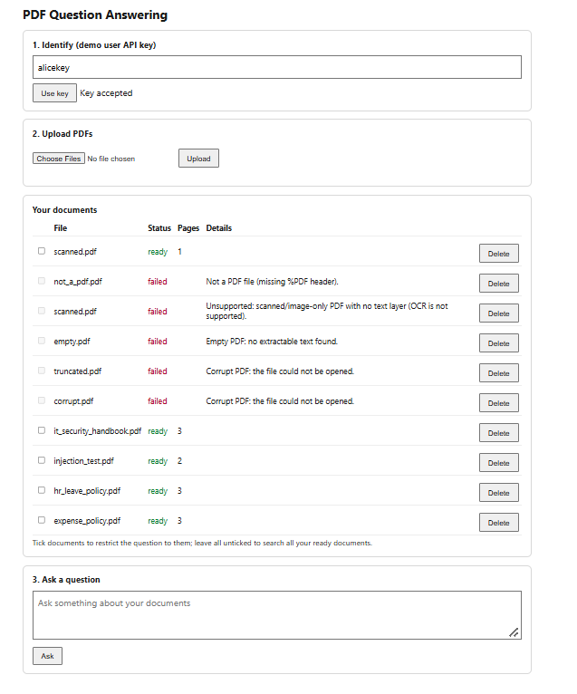
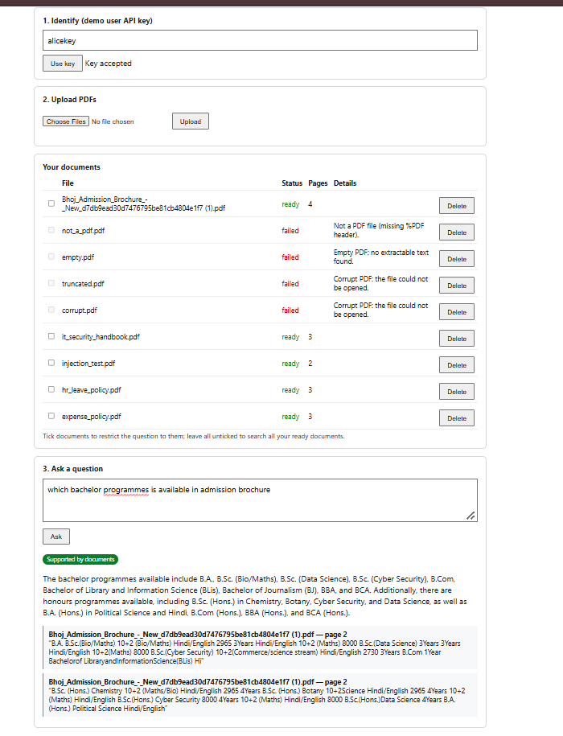

# PDF Question Answering with Citations

Upload PDFs, ask questions, and get answers that come **only from your own documents**.
Every answer shows where it came from: the file name, the PDF page number (starting at 1) and a short excerpt from that page.

There are two demo users, Alice and Bob. Each can only see their own documents.

Related documents:

- How it works and why I made these choices: [docs/TECHNICAL_DESIGN.md](docs/TECHNICAL_DESIGN.md)
- Test cases with expected and actual results: [eval/results.md](eval/results.md)

---

## Quick overview

1. You upload one or more PDFs.
2. The app reads each page, cuts the text into small chunks and stores them.
3. You ask a question. The app finds the most relevant chunks from **your** documents only.
4. A language model writes the answer from those chunks, and the server checks every citation against the stored page text.
5. If the documents do not contain the answer, the app says so instead of guessing.

---

## Step 1: What you need

- Python 3.12 (I used 3.12.10). Python 3.11 should also work.
- Git
- A free Gemini API key from <https://aistudio.google.com>
- About 500 MB of free disk space. The first upload downloads a small embedding model (about 90 MB).

I built and tested everything on Windows. The Mac/Linux commands below are the usual equivalents, but I have not run them myself.

---

## Step 2: Download the code

```powershell
git clone https://github.com/vaidehigupta25/pdfqa.git
cd pdfqa
```

---

## Step 3: Create a virtual environment and install the libraries

**Windows (PowerShell)**

```powershell
py -3.12 -m venv .venv
Set-ExecutionPolicy -Scope Process Bypass
.venv\Scripts\Activate.ps1
pip install -r requirements.txt
```

**Mac / Linux (not tested by me)**

```bash
python3 -m venv .venv
source .venv/bin/activate
pip install -r requirements.txt
```

When the environment is active, your prompt starts with `(.venv)`.

---

## Step 4: Set up your settings

Copy the example settings file:

**Windows**

```powershell
copy .env.example .env
```

**Mac / Linux**

```bash
cp .env.example .env
```

Now open `.env` in any editor and change these lines:

- `LLM_API_KEY`: paste your Gemini key here.
- `LLM_MODEL`: the model name. Free model names change often, so check the list in Step 5. The example file has a name that worked in my last run.

Everything else can stay as it is. The `.env` file is ignored by git, so no real secrets are in this repository.

Other settings you may want to know about:

- `ALICE_API_KEY` and `BOB_API_KEY`: the keys of the two demo users. They are demo values and you can change them.
- `LLM_PROVIDER`: I used `gemini`. The code also accepts `groq` and `ollama`, but I have not tested those two. There is also `extractive`, an offline rule-based mode that needs no key. It is only for testing.
- `EMBEDDING_BACKEND`: leave it as `fastembed`. It runs on your own computer for free.
- `MIN_SIMILARITY`: how similar a chunk must be to the question to be used. The default is 0.25.
- `MAX_UPLOAD_MB`: the biggest file you can upload. The default is 20.
- `OCR_ENABLED`: `false` by default. See Step 11 (optional).

---

## Step 5: Check that your key and model work

```powershell
python scripts/check_llm.py
```

This lists the models your key can use and times one tiny request.

- HTTP 429 means you used up the free quota. Wait and try again.
- A timeout means that model is slow. Try another name from the list.
- HTTP 404 means the model name does not exist. Pick a name from the list and put it in `.env`.

---

## Step 6: Start the app

```powershell
uvicorn app.main:app --port 8000
```

Leave this window open while you use the app. The two demo users are created automatically on startup.
The very first upload takes a little longer because it downloads the embedding model.

Open one of these in your browser:

- <http://127.0.0.1:8000> for the web page
- <http://127.0.0.1:8000/docs> for the interactive API page

---

## Step 7: The two demo users and the sample files

Alice's key (from `.env.example`): `alice-demo-key-change-me`
Alice's sample PDFs: `samples/alice/` (4 PDFs, including `injection_test.pdf`)

Bob's key (from `.env.example`): `bob-demo-key-change-me`
Bob's sample PDFs: `samples/bob/` (3 PDFs)

If you changed the keys in `.env`, use your own values instead.

`samples/invalid/` holds files that should be rejected: `corrupt.pdf`, `truncated.pdf`, `empty.pdf`, `scanned.pdf` (an image with no text) and `not_a_pdf.pdf`.
All sample files are made-up documents and are already in the repository.

---

## Step 8: Try it in the web page

1. Paste Alice's key into the first box and press **Use key**.
2. Choose one or more PDFs from `samples/alice/` and press **Upload**.
3. Wait until the status says `ready`.
4. Type a question, for example `How many days of paid annual leave do full-time employees get?`, and press **Ask**.
5. You get the answer plus a box for each citation (file name, page and excerpt).
6. To limit a question to certain documents, tick them first.
7. To see user isolation, switch to Bob's key. Bob's list is empty, and Bob cannot see Alice's documents.

---

## Step 9: Try it with the API

Every route except `/health` needs an `X-API-Key` header. The server works out who you are from the key, so you never send a user id.

The routes:

- `POST /documents`: upload a PDF (form field `file`). The status starts as `processing`, then becomes `ready` or `failed`.
- `GET /documents`: list your documents with their status and any error.
- `GET /documents/{id}`: the status of one document.
- `DELETE /documents/{id}`: delete one of your documents.
- `POST /ask`: ask a question. You can add `"document_ids": [...]` to limit it to some documents.
- `GET /health`: check that the app is running.

**Upload a file and list your documents** (use `curl.exe` in PowerShell, or `curl` on Mac/Linux):

```powershell
curl.exe -s -H "X-API-Key: alice-demo-key-change-me" -F "file=@samples/alice/hr_leave_policy.pdf" http://127.0.0.1:8000/documents
curl.exe -s -H "X-API-Key: alice-demo-key-change-me" http://127.0.0.1:8000/documents
```

**Ask a question** (PowerShell):

```powershell
$body = @{question="How many days of paid annual leave do full-time employees get?"} | ConvertTo-Json
Invoke-RestMethod -Method Post -Uri http://127.0.0.1:8000/ask -Headers @{"X-API-Key"="alice-demo-key-change-me"} `
  -ContentType "application/json" -Body $body | ConvertTo-Json -Depth 5
```

You can also open `/docs`, press **Try it out** on `POST /ask`, and fill in the key and the question.

### Real examples from my runs

**Upload** (HTTP 201). The status changes to `ready` after a few seconds:

```
{"id":"c050b39a-9d50-4fdc-ab77-3427adc1fd9d","filename":"hr_leave_policy.pdf","status":"processing","page_count":3}
```

**A question the documents can answer** (HTTP 200):

```
POST /ask   {"question": "How many days of paid annual leave do full-time employees get?"}
{
  "answer": "Full-time employees receive 24 days of paid annual leave each calendar year.",
  "supported": true,
  "citations": [{
    "document_id": "c050b39a-9d50-4fdc-ab77-3427adc1fd9d",
    "document_name": "hr_leave_policy.pdf",
    "page": 2,
    "excerpt": "Full-time employees receive 24 days of paid annual leave per calendar year."
  }],
  "top_score": 0.812, "provider": "gemini", "model": "gemini-flash-latest"
}
```

**A question that needs two PDFs** (HTTP 200). Both documents are cited:

```
POST /ask   {"question": "If I travel for business, are those days deducted from my annual leave, and how much can I claim for meals per day?"}
{
  "answer": "Days spent on approved business travel count as working days and are not deducted from your annual leave balance. For meals while traveling on business, you can claim reimbursement up to INR 1,500 per day.",
  "supported": true,
  "citations": [
    {"document_name": "hr_leave_policy.pdf", "page": 3, "excerpt": "Days spent on approved business travel count as working days and are not deducted from the annual leave balance."},
    {"document_name": "expense_policy.pdf",  "page": 2, "excerpt": "Meals while travelling on business are reimbursed up to INR 1,500 per day."}
  ]
}
```

**A question the documents cannot answer** (HTTP 200):

```
POST /ask   {"question": "What is the company policy on pet insurance for employees?"}
{"answer": "The uploaded documents do not contain enough information to answer this question.",
 "supported": false, "citations": [], "top_score": 0.402, "provider": "gemini", "model": "gemini-flash-latest"}
```

**Errors:**

```
Upload scanned.pdf    -> HTTP 422  {"detail":"Unsupported: scanned/image-only PDF with no text layer (OCR is not supported).", ...}
Upload corrupt.pdf    -> HTTP 422  {"detail":"Corrupt PDF: the file could not be opened.", ...}
Upload not_a_pdf.pdf  -> HTTP 415  {"detail":"Not a PDF file (missing %PDF header).", ...}
Bob asks for Alice's document id -> HTTP 404  {"detail":"Document not found"}
Gemini quota used up while asking -> HTTP 503  {"detail":"Language model unavailable: LLM unavailable after retries: HTTP 429 (rate limit/overload)"}
```

The `scanned.pdf` error above is what you get with OCR switched off, which is the default.

The full list of error codes (401, 404, 409, 413, 415, 422, 503) and when each one happens is in [docs/TECHNICAL_DESIGN.md](docs/TECHNICAL_DESIGN.md).

---

## Step 10: Run the tests and the evaluation

There are two kinds of checks. Run both.

**Automatic tests** (work offline, need no key and no model download):

```powershell
pytest -q
```

These check file validation, that one user cannot reach another user's documents, that citations match the original PDFs, and the error codes.
They use simple keyword-based stand-ins instead of the real language model, so they do not tell you how good the answers are.
The tests always run with OCR switched off, whatever your `.env` says. The OCR tests skip themselves if the OCR package is not installed.

**The real evaluation** (needs the app running with a working Gemini key):

1. Start the app in one window (Step 6).
2. In a second window, activate the environment and run:

```powershell
python eval/run_eval.py --delay 7
```

It deletes the demo users' documents, uploads the samples again, asks the questions, opens the original PDFs to check that every cited excerpt really is on the cited page, and writes `eval/results.md`.
The 7 second delay between questions keeps it under the free quota. Run it with OCR switched off.

**Result of my last run (14 October 2026, Gemini `gemini-3.1-flash-lite`):** all 15 checks passed, and all 5 citations were found on the cited page of the original PDF.
The six kinds of checks were: a supported question, a question across two PDFs, an unsupported question, an invalid upload, a cross-user access attempt and a PDF with misleading instructions.
This is one run on a small set of made-up documents. It shows the app works as designed, not how accurate it is on real documents.

Two small helper scripts are also included:

- `python scripts/check_citation.py hr_leave_policy.pdf 2 "24 days of paid annual leave"` checks one citation against the original PDF.
- `python scripts/inspect_data.py` shows the stored pages, chunks and embedding numbers for a document.

---

## Step 11 (optional): Turn on OCR for scanned PDFs

OCR is an optional bonus. It is **off by default**, so a normal install behaves exactly as described above.

1. Install the OCR library:

   ```powershell
   pip install -r requirements-ocr.txt
   ```

2. In `.env`, set `OCR_ENABLED=true`.
3. Restart the app.

Now an image-only PDF is read with RapidOCR and marked `ocr_used: true` in `GET /documents`.
With OCR on, `samples/invalid/scanned.pdf` is accepted too, because its picture contains a readable sentence.
There is also a better demo file, `samples/ocr/scanned_ocr.pdf`, which has four real sentences. Try this question on it:
`How many hours of free visitor parking are there?`

Things to know:

- OCR can misread words, and citations quote the OCR text, not a real text layer.
- OCR reads at most `OCR_MAX_PAGES` pages (20 by default). Longer scanned files are rejected with a clear message.
- I tested OCR on only a couple of small samples, so I cannot say how accurate it is on real scans.
- Before the evaluation or the tests, switch OCR off again (or leave it on in `.env`, because the tests ignore it, but the evaluation does not).

---

## Screenshots

Alice's documents, with ready files and failed uploads showing their error:


A question that needs two PDFs. Both are cited:


A question the documents cannot answer:


Bob sees only his own documents:


Bob cannot get Alice's information:


A scanned PDF before and after turning OCR on:





---

## What each assignment requirement maps to

- Multiple PDFs with status and clear errors: Step 8 and the error examples in Step 9.
- Grounded answers, including a question across two PDFs: the examples in Step 9.
- Citations with document name, page from 1 and excerpt: every `/ask` answer.
- Missing information stated clearly: the pet insurance example in Step 9.
- User isolation: Bob's screenshots, and the 404 example in Step 9.
- Working flow through API and UI: Steps 8 and 9.
- PDF instructions treated as evidence: `samples/alice/injection_test.pdf`, explained in the technical design.
- Reproducible from a clean checkout: Steps 1 to 6, with no secrets committed.
- Optional bonus done: OCR (Step 11). Not done: hybrid search, conversation history and Docker.

---

## Known limits and what I did not do

Not done optionals: hybrid search, conversation history and Docker.
Every required items and OCR is done.

Known limits:

- Without OCR, scanned PDFs are rejected with a clear message. With OCR, text can be misread.
- Tables and multi-column pages may be read in the wrong order.
- The server checks the citations, but the wording of the answer comes from the language model and is not checked automatically.
- The free Gemini quota is small and changes. While building this I hit HTTP 429 errors, timeouts and "provider overloaded" errors, and the app showed them as HTTP 503. If you see that, wait a minute and ask again.
- The search compares the question with every chunk one by one. That is fine for a few documents but too slow for a large collection.
- The API keys are simple demo keys, not real authentication.
- Failed uploads stay in the list until you delete them. If the server stops while a document is `processing`, that document stays stuck, so delete it and upload it again.

---

## Time spent

I spent about **20 hours over 3 days**.

- Setup and fixing problems (Python install, git and GitHub login, Gemini quota and timeouts): about 5 hours
- Building and checking each part (upload, search, answers, citations, user isolation, web page, tests): about 9 hours
- Running the evaluation, including getting a working language model: about 2 hours
- Writing the documents and taking screenshots: about 4 hours

The optional OCR feature was added afterwards and is not included in these numbers.

---

## AI tools and other people's code

- I used **Claude (Anthropic)** to plan the design and to write the first version of the code, the tests, the sample PDF generator, the evaluation script, the OCR feature and these documents.
  I ran every step on my own computer, checked the results myself (tests, the evaluation, attacks as the other user, and checking citations against the original PDFs), and I can explain how each part works.
- **Gemini** (`gemini-3.1-flash-lite`, free tier) is the language model used in the evaluation.
- Open-source libraries: FastAPI, Uvicorn, PyMuPDF, fastembed (model `all-MiniLM-L6-v2`), numpy, httpx, python-dotenv, ReportLab and pytest. For the optional OCR: RapidOCR (`rapidocr-onnxruntime`).
