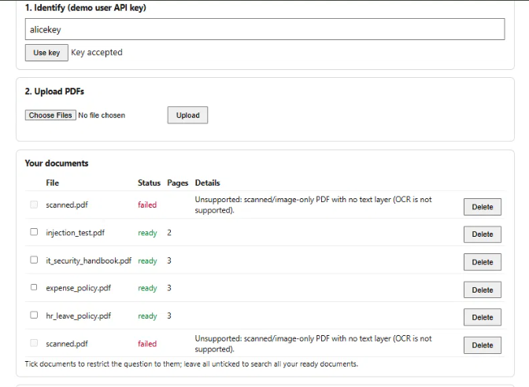
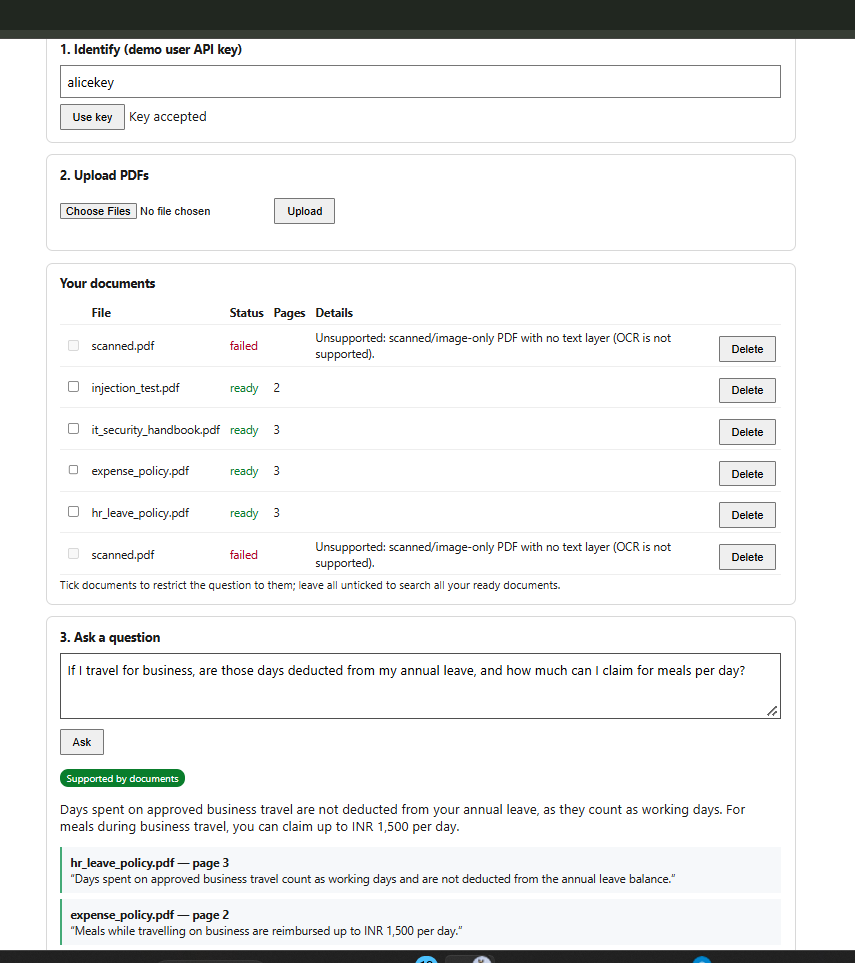
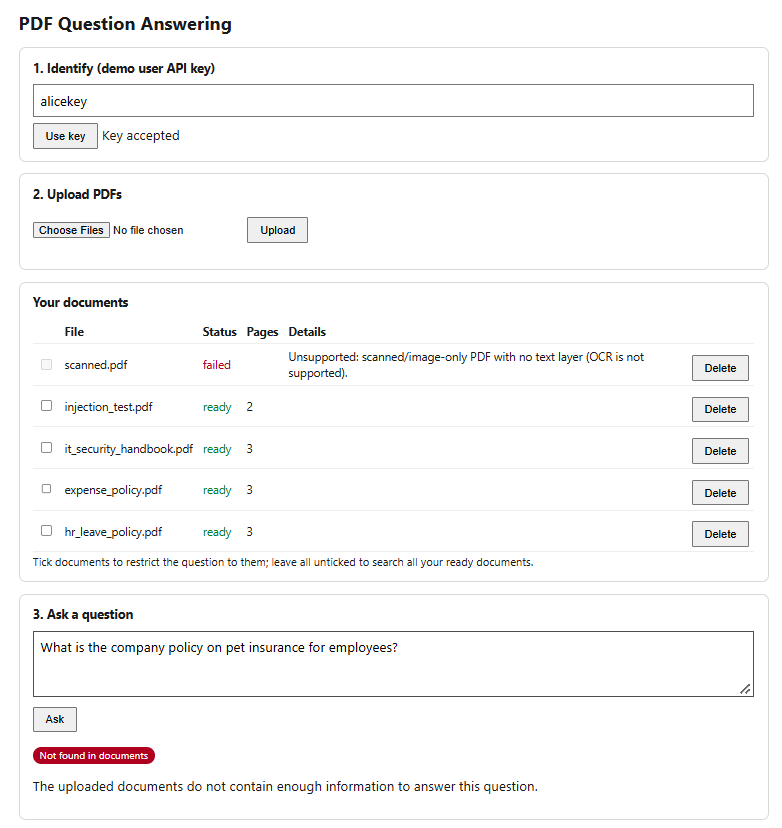
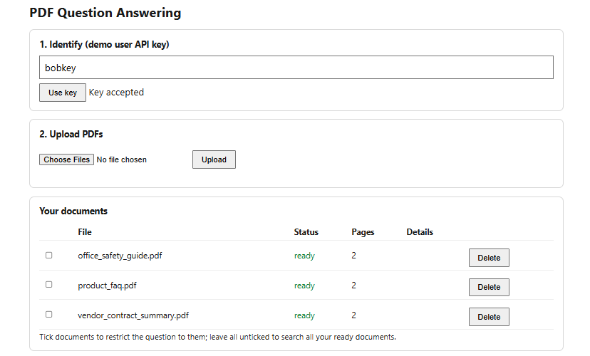
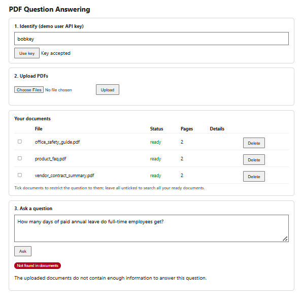

# PDF Question Answering with Citations

This is a small app where you upload PDFs and ask questions about them. It answers only from the PDFs you uploaded, and it shows
where each answer came from: the file name, the page number (starting at 1) and a short excerpt from that page.
There are two demo users, Alice and Bob, and each one can only see their own documents.

- How it works and why I made these choices: [docs/TECHNICAL_DESIGN.md](docs/TECHNICAL_DESIGN.md)
- Test results, expected vs actual: [eval/results.md](eval/results.md)

## What you need

- Python 3.11 or 3.12 (I used 3.12.10)
- Git
- A free Gemini API key from <https://aistudio.google.com>
- About 500 MB of free disk space. The first upload also downloads a small embedding model (about 90 MB).

I built and tested everything on Windows. The Mac/Linux commands below are the usual equivalents, but I have not run them myself.

## Setup

**Windows (PowerShell)**

```powershell
git clone https://github.com/vaidehigupta25/pdfqa.git
cd pdfqa
py -3.12 -m venv .venv
Set-ExecutionPolicy -Scope Process Bypass
.venv\Scripts\Activate.ps1
pip install -r requirements.txt
copy .env.example .env
```

**Mac / Linux (not tested by me)**

```bash
git clone https://github.com/vaidehigupta25/pdfqa.git
cd pdfqa
python3 -m venv .venv
source .venv/bin/activate
pip install -r requirements.txt
cp .env.example .env
```

Then open `.env` and put your Gemini key in `LLM_API_KEY`. The `.env` file is ignored by git, so no real secrets are in this repo.

## Settings (`.env`)

| Setting                        | What it does                                                                                 |
| ------------------------------ | -------------------------------------------------------------------------------------------- |
| `ALICE_API_KEY`, `BOB_API_KEY` | The keys for the two demo users. They are demo values, so you can change them.               |
| `LLM_PROVIDER`                 | I used `gemini`. The code also accepts `groq` and `ollama`, but I have not tested those two. |
| `LLM_API_KEY`                  | Your key from the provider.                                                                  |
| `LLM_MODEL`                    | The model name. Free model names change often, so check the list (see below).                |
| `EMBEDDING_BACKEND`            | Leave it as `fastembed`. It runs on your own computer for free.                              |
| `MIN_SIMILARITY`               | How similar a chunk must be to the question to be used. Default is 0.25.                     |
| `MAX_UPLOAD_MB`                | Biggest file you can upload. Default is 20.                                                  |

The automated tests switch to simple offline stand-ins by themselves, so you don't need to set anything for them.

**Check your key and model before you start:**

```powershell
python scripts/check_llm.py
```

It lists the models your key can use and times one tiny request. If you see HTTP 429, you hit the free quota. If it times out,
that model is slow, so try another name from the list. If you see 404, the model name doesn't exist.

## Start the app

```powershell
uvicorn app.main:app --port 8000
```

Open <http://127.0.0.1:8000> for the web page, or <http://127.0.0.1:8000/docs> for the interactive API page.
The two demo users are created automatically when the app starts. The very first upload takes a bit longer
because it downloads the embedding model.

## Demo users and sample files

| User  | API key (from `.env.example`) | Sample PDFs                                               |
| ----- | ----------------------------- | --------------------------------------------------------- |
| alice | `alice-demo-key-change-me`    | `samples/alice/` (4 PDFs, including `injection_test.pdf`) |
| bob   | `bob-demo-key-change-me`      | `samples/bob/` (3 PDFs)                                   |

`samples/invalid/` has files that should be rejected: `corrupt.pdf`, `truncated.pdf`, `empty.pdf`, `scanned.pdf` (an image with no text)
and `not_a_pdf.pdf`. All the samples are made-up documents and are already in the repo.

**Using the web page:**

1. Paste a key into the first box and press "Use key".
2. Upload one or more PDFs and wait until the status says `ready`.
3. Type a question and press Ask. You get the answer and a box for each citation.
4. To limit a question to certain documents, tick them first.

## API

Every route except `/health` needs an `X-API-Key` header. The server works out who you are from the key, so you never send a user id.

| Route                    | What it does                                                                                   | Possible errors                                                                                                                   |
| ------------------------ | ---------------------------------------------------------------------------------------------- | --------------------------------------------------------------------------------------------------------------------------------- |
| `POST /documents`        | Upload a PDF (form field `file`). It starts as `processing`, then becomes `ready` or `failed`. | 401, 413 too big, 415 not a PDF, 422 corrupt / password protected / empty / scanned                                               |
| `GET /documents`         | List your documents with their status and any error.                                           | 401                                                                                                                               |
| `GET /documents/{id}`    | Status of one document.                                                                        | 401, 404                                                                                                                          |
| `DELETE /documents/{id}` | Delete one of your documents.                                                                  | 401, 404                                                                                                                          |
| `POST /ask`              | Ask a question. You can add `"document_ids": [...]` to limit it.                               | 401, 404 (unknown or someone else's document), 409 (document not ready), 422 (empty question), 503 (language model not available) |
| `GET /health`            | Check the app is running.                                                                      | none                                                                                                                              |

**Upload and list (use `curl.exe` in PowerShell, or `curl` on Mac/Linux):**

```powershell
curl.exe -s -H "X-API-Key: alice-demo-key-change-me" -F "file=@samples/alice/hr_leave_policy.pdf" http://127.0.0.1:8000/documents
curl.exe -s -H "X-API-Key: alice-demo-key-change-me" http://127.0.0.1:8000/documents
```

**Ask a question (PowerShell):**

```powershell
$body = @{question="How many days of paid annual leave do full-time employees get?"} | ConvertTo-Json
Invoke-RestMethod -Method Post -Uri http://127.0.0.1:8000/ask -Headers @{"X-API-Key"="alice-demo-key-change-me"} `
  -ContentType "application/json" -Body $body | ConvertTo-Json -Depth 5
```

You can also use the `/docs` page, press "Try it out" on `POST /ask`, and fill in the key and the question.

### Real examples from my runs

Upload (HTTP 201). The status changes to `ready` after a few seconds:

```
{"id":"c050b39a-9d50-4fdc-ab77-3427adc1fd9d","filename":"hr_leave_policy.pdf","status":"processing","page_count":3}
```

A question the documents can answer (HTTP 200, taken from a run with `gemini-flash-latest`):

```
POST /ask   {"question": "How many days of paid annual leave do full-time employees get?"}
{
  "answer": "Full-time employees receive 24 days of paid annual leave each calendar year.",
  "supported": true,
  "citations": [{
    "document_id": "c050b39a-9d50-4fdc-ab77-3427adc1fd9d",
    "document_name": "hr_leave_policy.pdf",
    "page": 2,
    "excerpt": "Full-time employees receive 24 days of paid annual leave per calendar year."
  }],
  "top_score": 0.812, "provider": "gemini", "model": "gemini-flash-latest"
}
```

A question that needs two PDFs (HTTP 200). Both documents are cited:

```
POST /ask   {"question": "If I travel for business, are those days deducted from my annual leave, and how much can I claim for meals per day?"}
{
  "answer": "Days spent on approved business travel count as working days and are not deducted from your annual leave balance. For meals while traveling on business, you can claim reimbursement up to INR 1,500 per day.",
  "supported": true,
  "citations": [
    {"document_name": "hr_leave_policy.pdf", "page": 3, "excerpt": "Days spent on approved business travel count as working days and are not deducted from the annual leave balance."},
    {"document_name": "expense_policy.pdf",  "page": 2, "excerpt": "Meals while travelling on business are reimbursed up to INR 1,500 per day."}
  ]
}
```

A question the documents can't answer (HTTP 200):

```
POST /ask   {"question": "What is the company policy on pet insurance for employees?"}
{"answer": "The uploaded documents do not contain enough information to answer this question.",
 "supported": false, "citations": [], "top_score": 0.402, "provider": "gemini", "model": "gemini-flash-latest"}
```

Errors:

```
Upload scanned.pdf    -> HTTP 422  {"detail":"Unsupported: scanned/image-only PDF with no text layer (OCR is not supported).", ...}
Upload corrupt.pdf    -> HTTP 422  {"detail":"Corrupt PDF: the file could not be opened.", ...}
Upload not_a_pdf.pdf  -> HTTP 415  {"detail":"Not a PDF file (missing %PDF header).", ...}
Bob asks for Alice's document id -> HTTP 404  {"detail":"Document not found"}
Gemini quota used up while asking -> HTTP 503  {"detail":"Language model unavailable: LLM unavailable after retries: HTTP 429 (rate limit/overload)"}
```

## Tests and evaluation

```powershell
pytest -q
python eval/run_eval.py
```

- `pytest -q` runs offline. It needs no key and no model download. It checks file validation, that one user can't reach another user's
  documents, that citations match the original PDFs, and the error codes. It uses simple keyword-based stand-ins instead of the real
  language model, so it does not tell you how good the answers are.
- `python eval/run_eval.py` is the real test. The app must be running with a working Gemini key. It deletes the demo users' documents,
  uploads the samples again, asks the questions, opens the original PDFs to check that every cited excerpt is really on the cited page,
  and writes `eval/results.md`. It waits 7 seconds between questions to stay under the free quota.

**Result of my last run (14 October 2026, Gemini `gemini-3.1-flash-lite`):** all 15 checks passed, and all 5 citations were found on the
cited page of the original PDF. The six kinds of checks were: supported question, question across two PDFs, unsupported question, invalid upload,
cross-user access, and a PDF with misleading instructions. The full table is in [eval/results.md](eval/results.md).
It is one run on a small set of made-up documents, so it shows the app works as designed, not how accurate it is on real documents.

Two small helper scripts are also included:

- `python scripts/check_citation.py hr_leave_policy.pdf 2 "24 days of paid annual leave"` checks one citation against the original PDF.
- `python scripts/inspect_data.py` shows the stored pages, chunks and embedding numbers for a document.

## Screenshots

Alice's documents, with ready files and failed uploads showing their error:



A question that needs two PDFs. Both are cited:



A question the documents can't answer:



Bob sees only his own documents:



Bob can't get Alice's information:



## Limits and what I did not do

**Not done (all optional in the assignment):** OCR, hybrid search, conversation history and Docker. Every required item is done.

**Known limits:**

- Scanned PDFs are rejected with a clear message because there is no OCR. Tables and multi-column pages may be read in the wrong order.
- The server checks the citations, but the wording of the answer comes from the language model and is not checked automatically.
- The free Gemini quota is small and changes. While building this I hit HTTP 429 errors and timeouts, and the app showed them as HTTP 503.
- The search compares the question with every chunk one by one. That is fine for a few documents but too slow for a large collection.
- The API keys are simple demo keys, not real authentication.
- Failed uploads stay in the list until you delete them. If the server stops while a document is `processing`, that document stays stuck,
  so delete it and upload it again.

## Time spent

## Time spent

I spent about **20 hours over 3 days**.

- Setup and fixing problems (Python install, git and GitHub login, Gemini quota and timeouts): about 5 h
- Building and checking each part (upload, search, answers, citations, user isolation, web page, tests): about 9 h
- Running the evaluation, including getting a working language model: about 2 h
- Writing the documents and taking screenshots: about 4 h

## AI tools and other people's code

- I used **Claude (Anthropic)** to plan the design and to write the first version of the code, the tests, the sample PDF generator,
  the evaluation script and these documents. I ran every step on my own computer, checked the results myself (tests, the evaluation,
  attacks as the other user, and checking citations against the original PDFs), and I can explain how each part works.
- **Gemini** (`gemini-3.1-flash-lite`, free tier) is the language model used in the evaluation.
- Open-source libraries: FastAPI, Uvicorn, PyMuPDF, fastembed (model `all-MiniLM-L6-v2`), numpy, httpx, python-dotenv, ReportLab and pytest.
